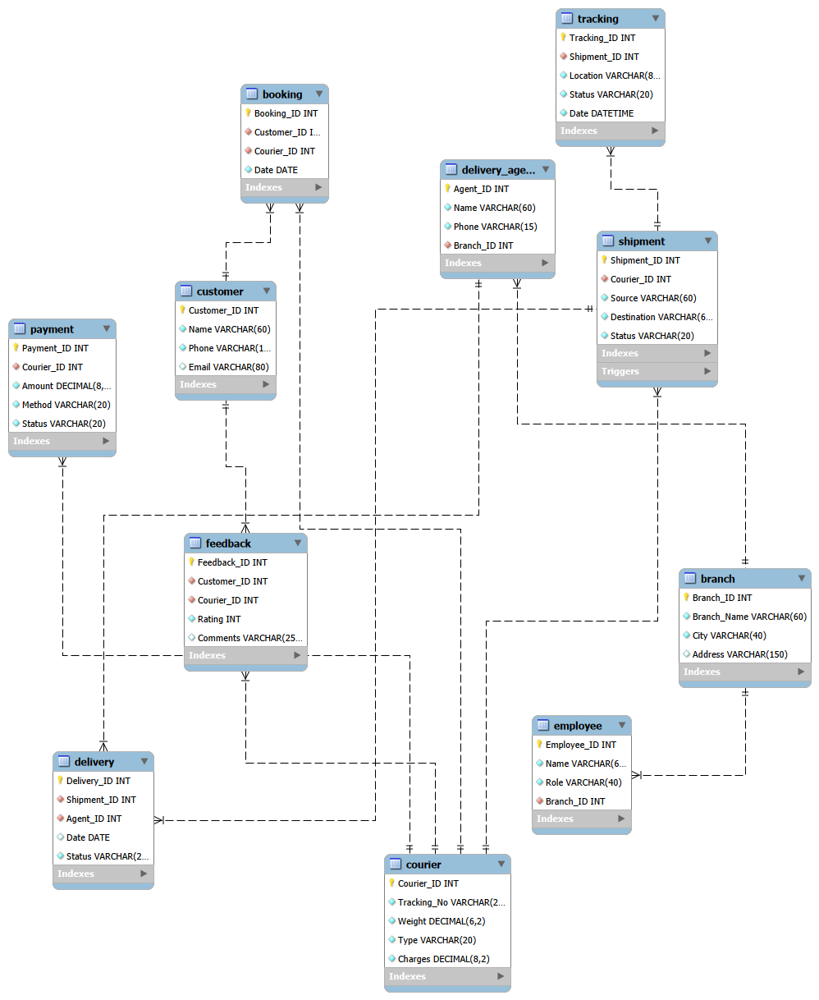
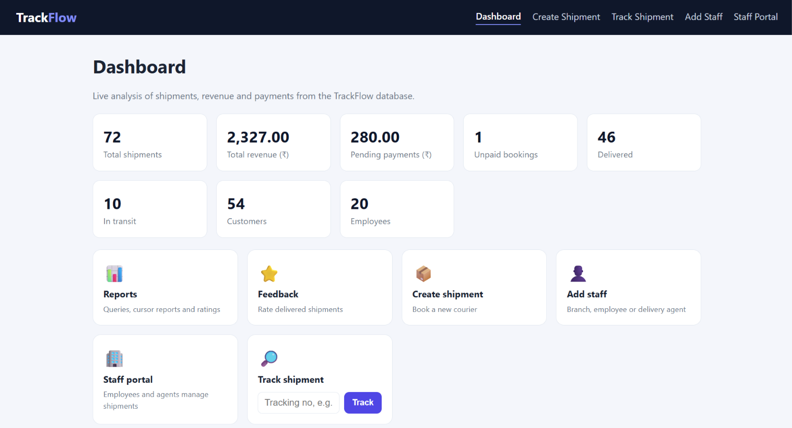
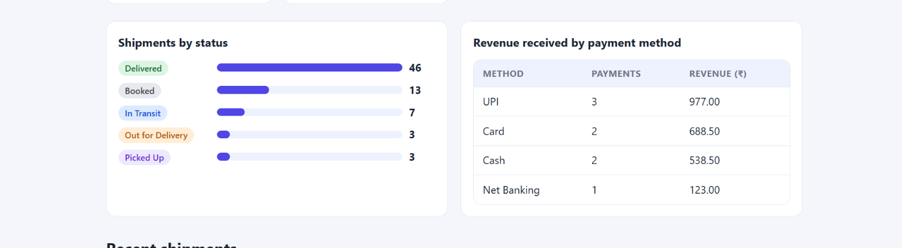
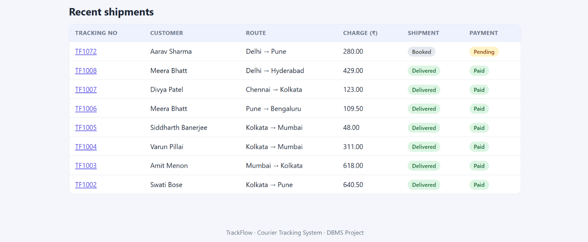
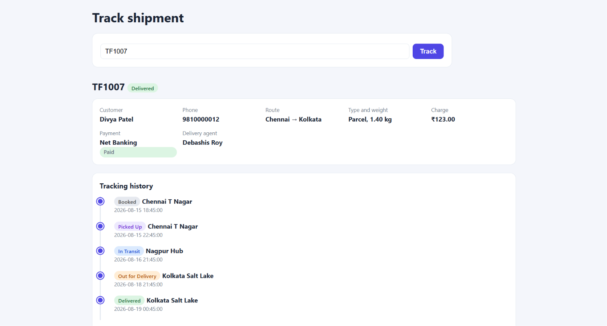
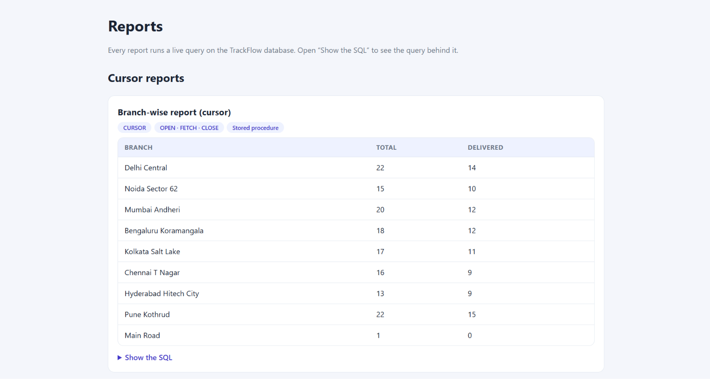
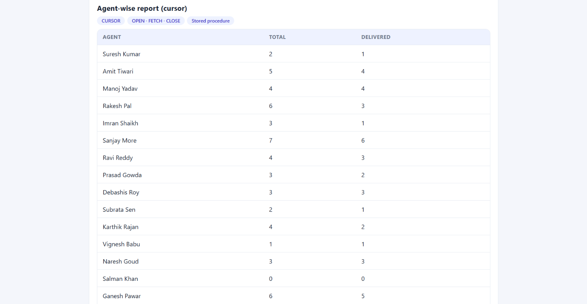
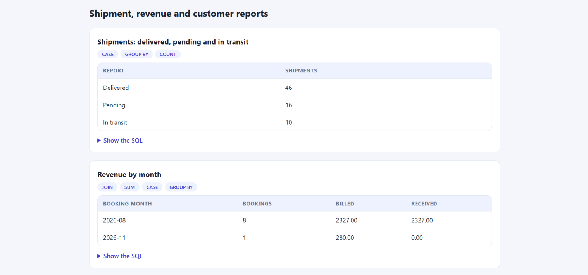
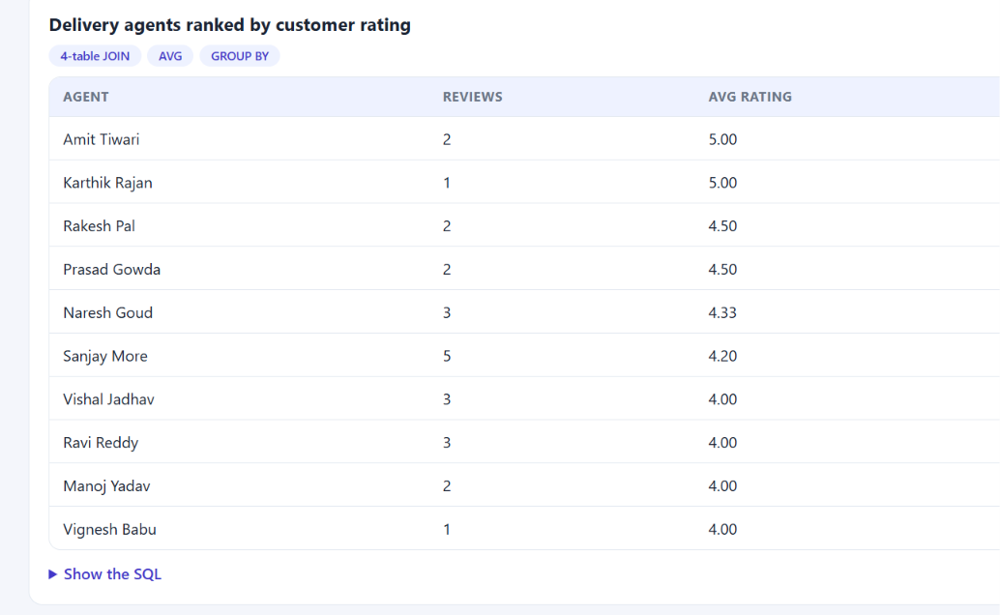

# TrackFlow – Courier Tracking System

## 1. Project Overview

TrackFlow is a DBMS-based Courier Tracking System developed using PHP and MySQL. It manages courier bookings, shipments, customers, employees, delivery agents, payments, tracking history, and customer feedback.

The system provides a centralized platform to manage courier operations and monitor shipment progress.

## 2. Technologies Used

- **Frontend:** HTML, CSS
- **Backend:** PHP
- **Database:** MySQL
- **Database Management Tool:** MySQL Workbench
- **Local Server:** XAMPP

## 3. Main Features

- Customer Registration
- Courier Booking
- Shipment Creation
- Shipment Tracking
- Employee Management
- Delivery Agent Management
- Shipment Status Updates
- Payment Management
- Customer Feedback and Ratings
- Reports and Analytics
- Dashboard

## 4. Database Tables

The project uses the following 11 tables:

1. Customer
2. Courier
3. Branch
4. Booking
5. Shipment
6. Payment
7. Feedback
8. Delivery_Agent
9. Employee
10. Tracking
11. Delivery

## 5. Entity Relationship (ER) Diagram

The ER diagram represents the database structure of TrackFlow and illustrates the relationships between its 11 entities.

It shows the primary keys, foreign keys, attributes, and relationships used in the Courier Tracking System.

### ER Diagram



[View ER Diagram](DBMS/TrackFlow_ER_Diagram.png)

### Main Relationships

- Customer – Booking: One-to-Many
- Customer – Feedback: One-to-Many
- Booking – Courier: One-to-One
- Courier – Shipment: One-to-One
- Shipment – Tracking: One-to-Many
- Shipment – Delivery: One-to-One
- Branch – Delivery Agent: One-to-Many
- Branch – Employee: One-to-Many
- Delivery Agent – Delivery: One-to-Many

## 6. Advanced SQL Concepts

The project demonstrates the following SQL concepts:

- SQL Joins
- Aggregate Functions
- Subqueries
- Stored Procedures
- User-defined Functions
- Triggers
- Cursors
- Transactions (COMMIT and ROLLBACK)

## 7. Project Structure

```text
TrackFlow-Courier-Tracking-System/
│
├── DBMS/
│   │
│   ├── Screenshot/
│   │   ├── Bookings.png
│   │   ├── Dashboard1.png
│   │   ├── Dashboard2.png
│   │   ├── Report1.png
│   │   ├── Report2.png
│   │   ├── Report3.png
│   │   ├── Tracking.png
│   │   └── report4.png
│   │
│   ├── TrackFlow_ER_Diagram.png
│   ├── Agent and branch performance reports.sql
│   ├── Customer and booking details.sql
│   ├── Databse & Relation Creation.sql
│   ├── Delivered, pending and in-transit reports.sql
│   ├── Demonstrating Functions.sql
│   ├── Feedback and rating reports.sql
│   ├── Payment and revenue reports.sql
│   ├── Shipment status and complete tracking history.sql
│   ├── code.mwb
│   ├── frnction_and_feture_creation.sql
│   └── insert_sample_data.sql
│
├── TrackFlow/
│   ├── add_employee.php
│   ├── create_shipment.php
│   ├── employee.php
│   ├── feedback.php
│   ├── index.php
│   ├── register.php
│   ├── reports.php
│   ├── track.php
│   ├── update_shipment.php
│   └── style.css
│
└── README.md
```

The repository is divided into two main folders:

- **DBMS:** Contains database creation scripts, sample data, SQL queries, advanced SQL implementations, website screenshots, the ER diagram, and the MySQL Workbench database model.
- **TrackFlow:** Contains the PHP application files and CSS stylesheet used to implement the courier tracking system.

The root directory contains the README.md file, which provides project documentation, setup instructions, database information, and implementation details.

## 8. Website Screenshots

The following screenshots demonstrate the working interface and major functionalities of the TrackFlow Courier Tracking System.

### 8.1 Dashboard

The dashboard provides an overview of courier operations and important statistics.

[](DBMS/Screenshot/Dashboard1.png)

[View Dashboard 1](DBMS/Screenshot/Dashboard1.png)

[](DBMS/Screenshot/Dashboard2.png)

[View Dashboard 2](DBMS/Screenshot/Dashboard2.png)

### 8.2 Courier Booking

Displays the courier booking interface used to manage courier bookings.

[](DBMS/Screenshot/Bookings.png)

[View Courier Booking Screenshot](DBMS/Screenshot/Bookings.png)

### 8.3 Shipment Tracking

Displays shipment tracking information and shipment progress.

[](DBMS/Screenshot/Tracking.png)

[View Shipment Tracking Screenshot](DBMS/Screenshot/Tracking.png)

### 8.4 Reports and Analytics

The following screenshots demonstrate the reporting and analytical features of TrackFlow.

[](DBMS/Screenshot/Report1.png)

[View Report 1](DBMS/Screenshot/Report1.png)

[](DBMS/Screenshot/Report2.png)

[View Report 2](DBMS/Screenshot/Report2.png)

[](DBMS/Screenshot/Report3.png)

[View Report 3](DBMS/Screenshot/Report3.png)

[](DBMS/Screenshot/report4.png)

[View Report 4](DBMS/Screenshot/report4.png)

## 9. Installation and Setup

1. Install XAMPP and MySQL.
2. Start Apache and MySQL.
3. Create the TrackFlow database by executing the database creation SQL file.
4. Execute the SQL file containing stored procedures, functions, triggers, and cursors.
5. Configure your local database connection in `TrackFlow/config.php`.
6. Place the project folder inside the XAMPP `htdocs` directory.
7. Open the application in your browser:

```text
http://localhost/TrackFlow/
```

**Note:** Configure your database credentials locally. Do not upload database passwords or private configuration files to GitHub.

## 10. Stored Procedures, Functions, Triggers, Cursors and Transactions

TrackFlow demonstrates advanced SQL programming concepts using MySQL.

The implementation is available mainly in:

`DBMS/frnction_and_feture_creation.sql`

### 10.1 Stored Function – Calculate_Charge()

The `Calculate_Charge()` function calculates courier charges according to the courier type and package weight.

**Pricing Logic:**

| Courier Type | Charge Calculation |
|---|---|
| Document | 40 + 20 × Weight |
| Parcel | 60 + 45 × Weight |
| Fragile | 80 + 70 × Weight |
| Express | 100 + 90 × Weight |

**Example Execution:**

```sql
SELECT Calculate_Charge('Parcel', 2.5);
```

**Expected Result:** 172.50

### 10.2 Stored Procedure – Book_Courier()

The `Book_Courier()` procedure handles the courier booking process.

It performs the following operations:

- Calculates courier charges using `Calculate_Charge()`.
- Generates a tracking number.
- Inserts courier details into the Courier table.
- Creates a booking in the Booking table.
- Creates shipment details in the Shipment table.
- Records payment details in the Payment table.
- Creates the initial tracking record in the Tracking table.
- Uses a transaction to commit the booking or roll back changes if an SQL error occurs.

**Example Execution:**

```sql
CALL Book_Courier(1, 'Express', 2.0, 'Delhi', 'Pune', 'Card');
```

The procedure returns the generated tracking number and calculated charges.

### 10.3 Trigger – Automatic Shipment Tracking

The trigger `trg_shipment_status_tracking` automatically inserts a new record into the Tracking table when a shipment's status changes.

**Example Execution:**

```sql
UPDATE Shipment
SET Status = 'Picked Up'
WHERE Shipment_ID = 60;
```

**Verify the Tracking History:**

```sql
SELECT Location, Status
FROM Tracking
WHERE Shipment_ID = 60
ORDER BY Date, Tracking_ID;
```

This demonstrates automatic tracking-history generation after a shipment status update.

### 10.4 Cursors – Branch-wise and Agent-wise Reports

TrackFlow uses cursors to process database records one by one.

**Branch-wise Report:**

```sql
CALL Branch_Report();
```

Processes each branch and calculates its associated shipment count and delivered shipment count.

**Agent-wise Report:**

```sql
CALL Agent_Report();
```

Processes each delivery agent and calculates the total deliveries and completed deliveries.

### 10.5 Transactions – COMMIT and ROLLBACK

Transactions demonstrate how database changes can be saved permanently or cancelled.

**ROLLBACK Example:**

```sql
START TRANSACTION;

UPDATE Payment
SET Status = 'Paid'
WHERE Courier_ID = 72;

ROLLBACK;
```

The update is cancelled.

**COMMIT Example:**

```sql
START TRANSACTION;

UPDATE Payment
SET Status = 'Paid'
WHERE Courier_ID = 72;

COMMIT;
```

The update is saved permanently.

The demonstration script also includes an invalid feedback-rating operation to illustrate transaction rollback.

**SQL Demonstration File:** `DBMS/Demonstrating Functions.sql`

---

## 11. Reports and Analytics

TrackFlow uses SQL queries and stored procedures to generate reports for analysing courier operations.

### 11.1 Customer and Booking Details

**SQL File:** `Customer and booking details.sql`

Provides customer and booking information, including booking counts and customer-related details.

SQL concepts demonstrated include:

- INNER JOIN
- LEFT JOIN
- GROUP BY
- COUNT()
- SUM()
- Aggregate Functions

### 11.2 Payment and Revenue Reports

**SQL File:** `Payment and revenue reports.sql`

Provides payment and revenue analysis, including:

- Paid and pending payment information.
- Revenue by payment method.
- Revenue by courier type.
- Pending payments with customer details.

SQL concepts demonstrated include:

- JOIN
- GROUP BY
- SUM()
- COUNT()
- WHERE
- ORDER BY

### 11.3 Feedback and Rating Reports

**SQL File:** `Feedback and rating reports.sql`

Provides customer feedback and rating analysis, including:

- Customer feedback details.
- Average, highest, and lowest ratings.
- Rating distribution.
- Delivered couriers without feedback.
- Average rating by delivery agent.

SQL concepts demonstrated include:

- INNER JOIN
- LEFT JOIN
- GROUP BY
- AVG()
- COUNT()
- MAX()
- MIN()
- ROUND()

### 11.4 Branch-wise and Agent-wise Performance Reports

**SQL File:** `frnction_and_feture_creation.sql`

The procedures `Branch_Report()` and `Agent_Report()` generate performance information using cursors.

**Execution:**

```sql
CALL Branch_Report();

CALL Agent_Report();
```

These procedures calculate branch-wise shipment performance and agent-wise delivery performance.

### 11.5 Additional Report Categories

The project also includes SQL files intended for:

- Delivered, pending, and in-transit shipment reports.
- Shipment status and complete tracking history.
- Agent and branch performance reports.

The report queries in these additional files need to be completed and tested before they can be presented as implemented outputs.

---

## 12. SQL Files

The `DBMS` folder contains the following important SQL files:

| SQL File | Purpose |
|---|---|
| `Databse & Relation Creation.sql` | Database and table creation |
| `frnction_and_feture_creation.sql` | Functions, procedures, triggers, and cursors |
| `Demonstrating Functions.sql` | Demonstration of advanced SQL concepts |
| `Customer and booking details.sql` | Customer and booking reports |
| `Payment and revenue reports.sql` | Payment and revenue analysis |
| `Feedback and rating reports.sql` | Feedback and rating analysis |
| `insert_sample_data.sql` | Sample data insertion |

**Note:** The SQL scripts must use a consistent database schema. Check that `insert_sample_data.sql` matches the table definitions in the main database creation script before executing it.

---

## 13. Team Project

TrackFlow is developed as an academic DBMS project to demonstrate database design, SQL concepts, and PHP-MySQL integration.

**Project Name:** TrackFlow – Courier Tracking System

**Database:** MySQL

**Backend:** PHP

**Institution:** Jaypee Institute of Information Technology, Noida
